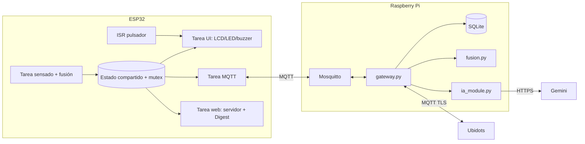
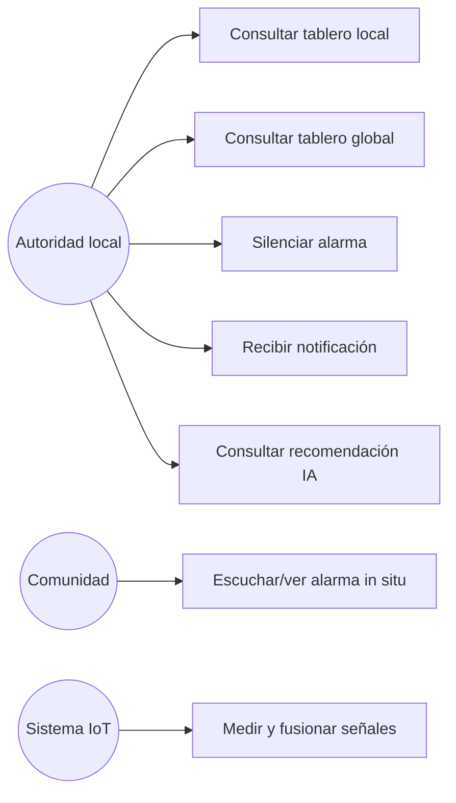
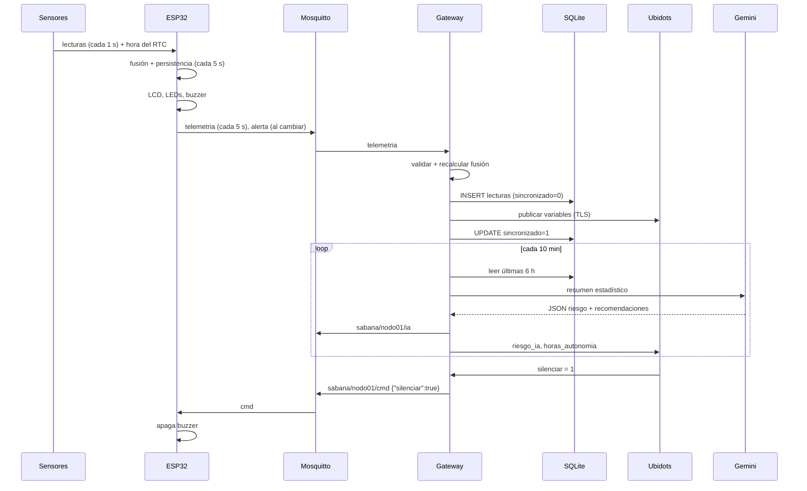
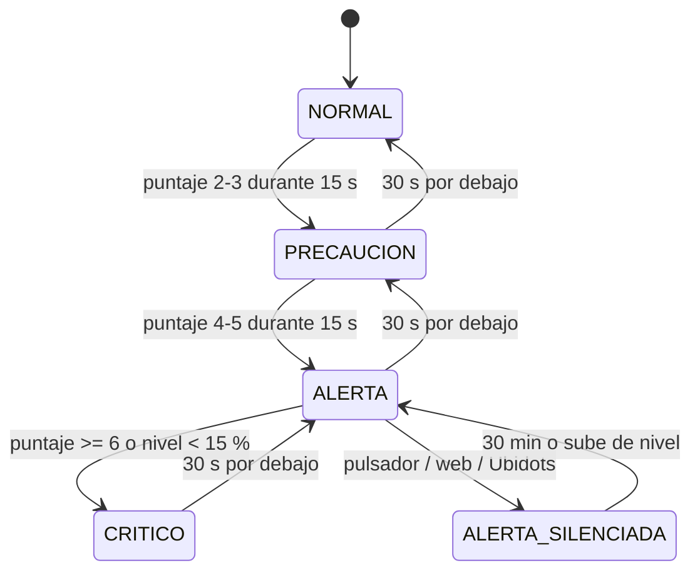
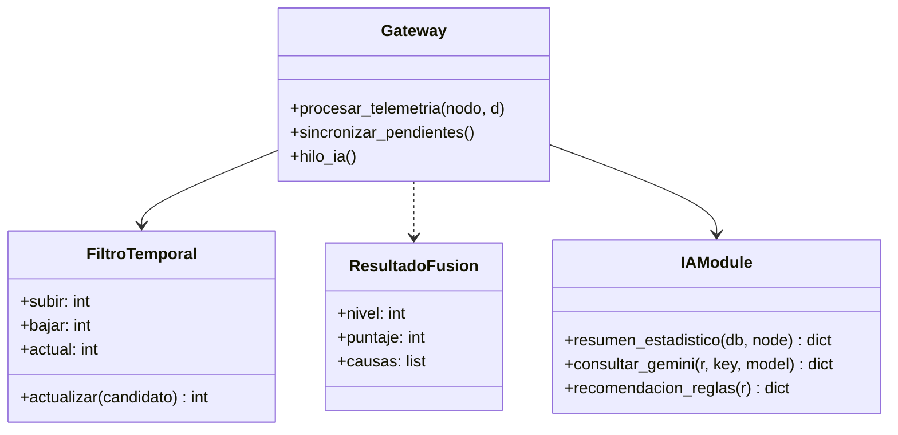
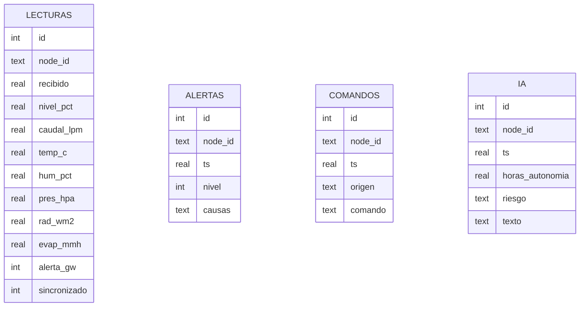

# 2. Solución propuesta

## 2.1 Restricciones de diseño
<!-- Copien y ajusten la tabla de restricciones de la guía (técnicas, económicas, regulatorias, espacio, escalabilidad, temporales, energéticas). -->

| Tipo | Restricción | Cómo se resolvió |
|---|---|---|
| Técnica | Medición y transmisión fuera del hilo principal | ISR + tareas FreeRTOS |
| ... | ... | ... |

## 2.2 Arquitectura propuesta

### Diagrama de bloques de hardware
```mermaid
flowchart LR
  subgraph Nodo["Nodo IoT Aqua-Sabana (ESP32 CH340)"]
    US[HC-SR04 nivel] -->|GPIO5 TRIG / GPIO18 ECHO con divisor| ESP[ESP32]
    BME[BME280 T/HR/P 0x76] -->|I2C| ESP
    BH[BH1750 luz 0x23] -->|I2C| ESP
    RTC[RTC DS3231 0x68] -->|I2C| ESP
    ESP -->|I2C 0x27| LCD[LCD 16x2]
    ESP -->|GPIO23| BZ[Buzzer activo]
    ESP -->|GPIO25/26/27| LED[LEDs azul, amarillo, rojo]
  end
  ESP -. WiFi 2.4 GHz .-> RPI[Raspberry Pi 5 Gateway]
  RPI -. Internet .-> UBI[Ubidots]
  RPI -. HTTPS .-> GEM[API Gemini]
```
> El kit no incluye caudalímetro: el sistema mide nivel (el enunciado pide "nivel y/o caudal"). El firmware queda preparado para agregar un YF-S201 por interrupción (`CAUDAL_MODO`).

### Diagrama de bloques de software


## 2.3 Desarrollo teórico modular

### Criterios de diseño
<!-- Por qué cada sensor (rango, precisión, costo, interfaz), por qué MQTT (ligero, pub/sub, QoS, LWT), por qué SQLite, por qué Ubidots, por qué Gemini. -->

### Modelos matemáticos
- Nivel: N% = (d_vacío − d) / (d_vacío − d_lleno) × 100 (mediana de 5 lecturas)
- Caudal: Q [L/min] = f [Hz] / 7,5
- Tasa de cambio: ventana de 10 min, %/h
- Evaporación potencial: Priestley-Taylor horaria (ver guía)

### Lógica de fusión
<!-- Tabla de puntaje y de niveles, persistencia 3/6 evaluaciones, silenciamiento. -->

## 2.4 Diagramas UML

### Casos de uso


### Diagrama de secuencia: de la medición a la alerta global


### Diagrama de estados de la alerta


### Diagrama de clases del gateway


### Modelo de datos (SQLite)


## 2.5 Esquemático de hardware
<!-- Imagen del esquemático (KiCad/Fritzing/Wokwi), tabla de pines, divisores de voltaje, transistor del buzzer. -->


## 2.6 Estándares de ingeniería aplicados
| Estándar | Aplicación |
|---|---|
| IEEE 802.11 b/g/n | WiFi del ESP32 y la Raspberry |
| MQTT 3.1.1 (OASIS, ISO/IEC 20922) | Comunicación nodo–gateway–nube, QoS, Last Will |
| TLS 1.2 | MQTT seguro hacia Ubidots (puerto 8883) |
| RFC 7616 (HTTP Digest) | Autenticación del tablero local |
| RFC 8259 (JSON) | Formato de mensajes |
| I2C (NXP UM10204) | BME280, BH1750, DS3231, LCD 16x2 |
| ISO/IEC 30141 | Arquitectura de referencia IoT (capas) |
| UML 2.5 (ISO/IEC 19505) | Diagramas de diseño |
| IEC 60529 (IP65) | Grado de protección de la caja |
| Ley 1581 de 2012 | Protección de datos de los usuarios |
| Resolución 0330 de 2017 (RAS) | Contexto de sistemas de agua potable |

## 2.7 Modelo de negocio
| Bloque (Lean Canvas) | Contenido |
|---|---|
| Problema | Municipios sin monitoreo en tiempo real de tanques comunitarios durante El Niño |
| Clientes | Alcaldías de Sabana Centro, acueductos veredales, juntas de acción comunal, distritos de riego |
| Propuesta de valor | Alerta temprana validada + predicción de autonomía por < 250.000 COP por punto |
| Solución | Nodo IoT + gateway local + tablero en la nube + IA |
| Canales | CAR, UAEGRD, convocatorias de gestión del riesgo |
| Ingresos | Venta del nodo + suscripción mensual por punto monitoreado (tablero, IA, soporte) |
| Costos | Hardware, nube, API de IA, instalación y mantenimiento |
| Métricas | Puntos monitoreados, horas de anticipación de alertas, falsas alarmas |
| Ventaja | Bajo costo y alarma local que funciona sin Internet |
